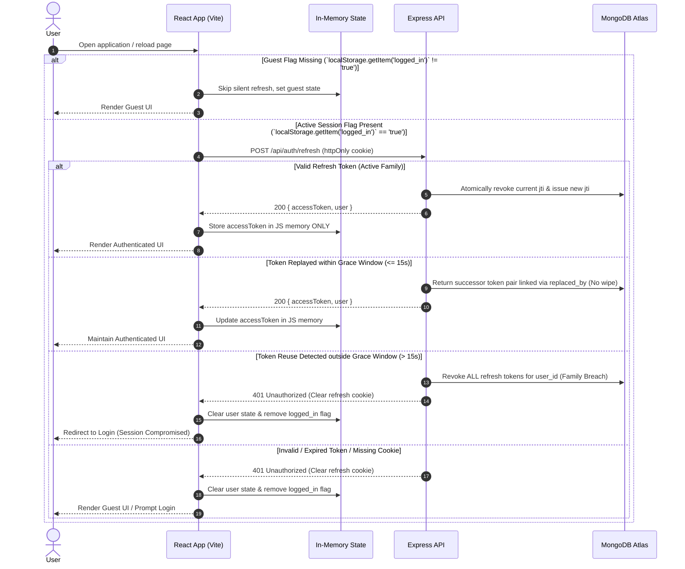

# NestMate React SPA Migration Plan (Production Blueprint)

## 1. Architecture Paradigm & Token Lifecycle



---

## 2. Technology Stack Specification

| Layer | Technology | Key Specification |
|---|---|---|
| **Build Tooling** | Vite 5 | React plugin, `loadEnv` integration in `vite.config.js`, proxy to `http://localhost:5000` |
| **Frontend Core** | React 18 | StrictMode-safe lifecycle, functional components, Hooks |
| **State & Cache** | TanStack Query v5 | Server state caching, query invalidation, optimistic updates |
| **Routing** | React Router v6 | Nested layouts, code splitting (`lazy` / `Suspense`), role guards |
| **Form Management** | React Hook Form + Zod | Schema-validated forms matching backend validation schemas |
| **Styling** | Tailwind CSS 3 | Design token system mapped to custom palette |
| **Mapping** | Leaflet + React-Leaflet | OpenStreetMap tiles, custom pin markers, coordinate synchronization |
| **HTTP Client** | Axios 1.x | Shared in-flight refresh promise, 401 queue interceptor, `withCredentials: true` |
| **Linter / Security** | ESLint | Rule `"react/no-danger": "error"` enforced |
| **Backend Testing** | Jest + Supertest + MongoMemoryReplSet | Concurrency race tests under replica set transactions, token reuse tests, auth guard matrix |
| **Frontend Testing** | Vitest + React Testing Library | AuthContext lifecycle, interceptor queue, modal validation |
| **E2E Testing** | Playwright | Student and owner workflows against seeded test DB with email/password authentication |

---

## 3. Client Route Table

| Route | Guard | API Calls | Purpose |
|---|---|---|---|
| `/` | Public | `GET /api/listings?limit=6` | Landing page, featured property showcase |
| `/browse` | Public | `GET /api/listings?page=&limit=&sort=&room_type=&location=`, `GET /api/listings/map` | Searchable listing catalog, filter drawer, Leaflet map |
| `/property/:id` | Public | `GET /api/listings/:id`, `POST /api/bookings` (Student only) | Property details, image carousel, booking request modal |
| `/login` | Guest Only | `POST /api/auth/login`, `POST /api/auth/send-otp`, `POST /api/auth/verify-otp` | Password login, phone OTP login |
| `/register` | Guest Only | `POST /api/auth/register` | Dedicated user account registration |
| `/complete-profile` | Protected (`isLoggedIn`) | `POST /api/auth/complete-profile` | Required profile setup for newly verified OTP users |
| `/dashboard` | Protected (`student` or `owner`) | Student: `GET /api/bookings/my`<br>Owner: `GET /api/bookings/owner`, `GET /api/listings/owner/mine`, `PATCH /api/bookings/:id`, `PATCH /api/listings/:id/availability`, `DELETE /api/listings/:id` | User booking and listing management console |
| `/listing/new` | Protected (`owner`) | `POST /api/listings` | Property creation form with image upload |
| `/edit/:id` | Protected (`owner` or `admin`) | `GET /api/listings/:id`, `PUT /api/listings/:id` | Property update form |
| `/admin` | Protected (`admin`) | `GET /api/admin/listings`, `PATCH /api/admin/listings/:id`, `GET /api/admin/users`, `PATCH /api/admin/users/:id/status`, `GET /api/admin/logs?page=&limit=` | Property moderation, user status toggle, audit log viewer |

---

## 4. Phase 0: Backend Security Hardening, Data Integrity & API Core

### 0.1 Security Hardening Checklist
1. **Rotate Secrets & Exclude Environment Files from Backups**
   - **Target File**: `scripts/create_backup.js`, `backend/.env`, git history
   - **Fix**: Rotate MongoDB Atlas user password, Gmail App Password, and Fast2SMS key. Update `create_backup.js` zip exclusion list with `".env"` and `"backend/.env"`. Verify git history contains no committed credentials.
   - **Acceptance Test**: Run `node scripts/create_backup.js`; verify via `unzip -l <zip_path>` that no `.env` file exists in the archive.

2. **Password Leak Prevention & N+1 Aggregation in User Management**
   - **Target File**: `backend/controllers/adminController.js`
   - **Fix**: Add `.select('-password')` to user queries. Replace the N+1 `Promise.all(rawUsers.map(...countDocuments))` loop in `getAllUsers` with a single `$lookup` from `listings` grouped by `owner_id`.
   - **Acceptance Test**: `GET /api/admin/users` returns user objects with `listing_count` where `password` is undefined across all records, executing in a single query.

3. **Legacy innerHTML XSS Remediation & React Danger Ban**
   - **Target File**: `backend/public/**/*.html`, `frontend/.eslintrc.json`
   - **Fix**: Remove unescaped variable interpolations in legacy page templates. Add ESLint rule `"react/no-danger": "error"` in frontend configuration to reject `dangerouslySetInnerHTML`.
   - **Acceptance Test**: Running `npm run lint` in `frontend/` fails if any component includes `dangerouslySetInnerHTML`.

4. **Regex ReDoS Mitigation & Search Input Sanitation**
   - **Target File**: `backend/controllers/listingsController.js`
   - **Fix**: Escape all regex metacharacters in `location` and `search` using `input.replace(/[.*+?^${}()|[\]\\]/g, '\\$&')`. Restrict query string length to 50 characters maximum.
   - **Acceptance Test**: Requesting `GET /api/listings?location=((((((((a+)+)+)+)+)+)+)+)+$` completes in < 20ms without CPU spikes.

5. **Eliminate Hardcoded JWT Secret Fallbacks**
   - **Target File**: `backend/utils/tokens.js`, `backend/server.js`
   - **Fix**: Remove hardcoded fallback strings `'dev_access_secret_...'` and `'dev_refresh_secret_...'`. Add bootstrap validation throwing a fatal error if `ACCESS_TOKEN_SECRET` or `REFRESH_TOKEN_SECRET` is missing or shorter than 32 characters.
   - **Acceptance Test**: Starting `backend/server.js` with an empty or 16-character `ACCESS_TOKEN_SECRET` terminates process with exit code 1.

6. **Seed Admin Credentials Sanitization**
   - **Target File**: `backend/server.js`, `backend/scripts/seed.js`
   - **Fix**: Delete hardcoded `admin@nestmate.com / admin123` startup console output. Read initial admin seed credentials strictly from `process.env.SEED_ADMIN_EMAIL` and `process.env.SEED_ADMIN_PASSWORD`.
   - **Acceptance Test**: Grepping server output on startup reveals no credential strings; database seeding reads admin password from environment variables only.

7. **Cryptographic OTP Generation, HMAC Hashing & Timing-Safe Verification**
   - **Target File**: `backend/controllers/authController.js`, `backend/models/OtpStore.js`
   - **Fix**: Replace `Math.random` with `crypto.randomInt(100000, 1000000)`. Store OTP as an HMAC-SHA256 digest (`crypto.createHmac('sha256', SECRET).update(otp).digest('hex')`). Verify inputs via `crypto.timingSafeEqual(Buffer.from(candidateHash), Buffer.from(storedHash))`.
   - **Acceptance Test**: Automated unit test asserts that `crypto.timingSafeEqual` is executed in the verification flow and that the stored value in `OtpStore` is an HMAC-SHA256 digest.

8. **Rate Limiting, Reverse Proxy Trust & Security Headers**
   - **Target File**: `backend/server.js`, `backend/package.json`
   - **Fix**:
     - Configure `app.set('trust proxy', 1)`.
     - Mount `helmet()`.
     - Exempt `/api/auth/refresh` from global auth rate limiters.
     - Apply login limiter (5 req/15 min) keyed on `req.ip + '_' + (req.body.email || '')`.
     - Apply send-otp limiter keyed per phone (3 req/15 min), per IP (10 req/15 min), with daily cap (5 OTPs/phone/day).
   - **Acceptance Test**: Rapid requests to `/api/auth/refresh` do not trigger rate limiting; 6th rapid login attempt from same IP with identical email returns HTTP 429; 6th rapid login attempt with different email succeeds.

9. **Refresh Token Reuse Detection, TTL Index & Grace Window**
   - **Target File**: `backend/models/RefreshToken.js`, `backend/controllers/authController.js`
   - **Fix**:
     - Update `expires_at` in `RefreshToken.js` to `Date` type with index `{ expireAfterSeconds: 0 }`.
     - Add `replaced_by: { type: String, default: null }` to schema.
     - On token rotation, set `revoked_at = new Date()` and record successor `jti` in `replaced_by`.
     - When receiving a token with `revoked_at != null`:
       - If `Date.now() - revoked_at.getTime() <= 15000` (15s grace window for multi-tab races), issue new token pair linked via `replaced_by` without chain invalidation.
       - If `Date.now() - revoked_at.getTime() > 15000` (replay outside window), execute `RefreshToken.deleteMany({ user_id: decoded.userId })` to revoke all active tokens.
   - **Acceptance Test**: Submitting a revoked token within 10 seconds returns HTTP 200 and preserves user session; submitting a revoked token after 20 seconds returns HTTP 401 and deletes all tokens for that user ID.

10. **Atomic Booking Concurrency under Replica Set Transaction**
    - **Target File**: `backend/controllers/bookingsController.js`
    - **Fix**: Validate booking status transition strictly from `pending` to `accepted` or `rejected`. On acceptance, execute `Listing.findOneAndUpdate({ _id: listingId, is_available: 1 }, { is_available: 0 }, { session })` inside a MongoDB transaction session (`session.withTransaction()`). Return HTTP 409 if matched count is 0. Auto-reject remaining pending bookings for that listing within the same transaction.
    - **Acceptance Test**: Two concurrent `PATCH` requests to accept bookings for the same listing run against `MongoMemoryReplSet`; exactly one receives HTTP 200 and the other receives HTTP 409.

11. **Registration Route Redirection & Error Status Handling**
    - **Target File**: `backend/server.js`
    - **Fix**: Remove dead static route `/register` pointing to empty directory. Update global Express error handler to prioritize `res.status(err.status || err.statusCode || 500)`.
    - **Acceptance Test**: Passing an error with `err.status = 403` to `next()` returns HTTP 403 JSON instead of HTTP 500.

12. **Unified Port Standard Across Environments**
    - **Target File**: `backend/server.js`, `Dockerfile`, `backend/.env.example`, `README.md`, `frontend/vite.config.js`
    - **Fix**: Standardize on port `5000` across all files, configuration templates, and proxies while retaining `process.env.PORT` override.
    - **Acceptance Test**: Running the backend without env overrides listens on port `5000`; Vite dev proxy routes traffic directly to `http://localhost:5000`.

13. **Multi-Stage Alpine Docker Build & Image Exclusion**
    - **Target File**: `Dockerfile`, `.dockerignore`
    - **Fix**:
      - Replace Ubuntu container with multi-stage `node:20-alpine` (frontend build stage -> production runner stage).
      - Run `npm ci --omit=dev`.
      - Run under unprivileged user `USER node`.
      - Implement `HEALTHCHECK --interval=30s --timeout=5s --start-period=5s --retries=3 CMD wget --no-verbose --tries=1 --spider http://localhost:${PORT}/api/health || exit 1`.
      - Execute process via `CMD ["node", "backend/server.js"]`.
      - Add `node_modules`, `backend/node_modules`, and `backend/uploads` to `.dockerignore`.
   - **Acceptance Test**: `docker build -t nestmate .` creates an image < 180MB; container health check passes using dynamic `${PORT}`.

14. **Cloudinary Asset Storage, Magic-Byte Validation & Image Migration**
    - **Target File**: `backend/routes/listings.js`, `backend/controllers/listingsController.js`, `scripts/migrate_images.js`
    - **Fix**: Replace local disk Multer with `multer.memoryStorage()`. Validate image magic bytes using `file-type` buffer inspection. Upload validated buffers to Cloudinary via stream, saving HTTPS URLs to MongoDB. Provide `scripts/migrate_images.js` to transfer existing `/uploads` files to Cloudinary.
    - **Acceptance Test**: Uploading a `.php` file renamed to `.png` returns HTTP 400; valid image upload stores Cloudinary HTTPS URL in MongoDB.

### 0.2 Query, Filter & Mutation Capabilities
15. **Listing Pagination & Envelope Metadata**
    - **Target File**: `backend/controllers/listingsController.js`
    - **Fix**: Add support for `?page=1&limit=6`. Return pagination envelope `{ listings, pagination: { total, page, totalPages, hasMore } }`.
    - **Acceptance Test**: `GET /api/listings?page=2&limit=2` returns 2 items with valid pagination metadata.

16. **Listing Sorting**
    - **Target File**: `backend/controllers/listingsController.js`
    - **Fix**: Add query parameter `?sort=price_asc|price_desc|newest`. Apply matching `$sort` stage in aggregation pipeline.
    - **Acceptance Test**: `GET /api/listings?sort=price_asc` returns records in ascending price order.

17. **Room Type Classification**
    - **Target File**: `backend/models/Listing.js`, `backend/controllers/listingsController.js`
    - **Fix**: Add schema field `room_type: { type: String, enum: ['single', 'shared', 'studio', 'apartment'], default: 'single' }`. Add filter support for `?room_type=`.
    - **Acceptance Test**: Querying `GET /api/listings?room_type=studio` returns only listings with `room_type: 'studio'`.

18. **Listing Modification Endpoint**
    - **Target File**: `backend/routes/listings.js`, `backend/controllers/listingsController.js`
    - **Fix**: Implement `PUT /api/listings/:id` protected by `isLoggedIn` and listing owner/admin check. Support updates to title, price, description, amenities, and room_type.
    - **Acceptance Test**: Non-owner receives HTTP 403; listing owner updates fields and receives HTTP 200 with updated payload.

### 0.3 Schema Integrations & Core Backend Additions
19. **User Status Enforcement (`is_active`)**
    - **Target File**: `backend/models/User.js`, `backend/controllers/authController.js`, `backend/middleware/auth.js`, `backend/controllers/adminController.js`, `backend/routes/admin.js`
    - **Fix**:
      - Add `is_active: { type: Boolean, default: true }` to `User.js`.
      - Check `user.is_active !== false` in `login`, `refresh`, and `isLoggedIn` middleware; return HTTP 403 if inactive.
      - Implement `PATCH /api/admin/users/:id/status` with body `{ is_active: boolean }`.
      - On deactivating a user, immediately execute `RefreshToken.deleteMany({ user_id: targetUserId })`.
    - **Acceptance Test**: Suspended user calling `/api/auth/refresh` or protected route receives HTTP 403; all refresh tokens for that user ID are deleted from database.

20. **Server-Side Validation on Write Routes**
    - **Target File**: `backend/middleware/validate.js`, `backend/validators/*.js`, write route files
    - **Fix**: Implement Zod request body validation middleware. Apply schemas to `POST /api/auth/register`, `POST /api/auth/login`, `POST /api/auth/send-otp`, `POST /api/auth/verify-otp`, `POST /api/auth/complete-profile`, `POST /api/listings`, `PUT /api/listings/:id`, and `POST /api/bookings`.
    - **Acceptance Test**: Sending invalid body schema (e.g. negative price, malformed phone) returns HTTP 400 with structured validation errors without hitting controller logic.

21. **GeoJSON Schema, 2dsphere Index, Migration & Capped Map Endpoint**
    - **Target File**: `backend/models/Listing.js`, `backend/scripts/migrate_geo.js`, `backend/routes/listings.js`, `backend/controllers/listingsController.js`
    - **Fix**:
      - Define `location_geo` without default `type: 'Point'` to avoid index failure on empty documents:
        ```javascript
        location_geo: {
          type: { type: String, enum: ['Point'] },
          coordinates: { type: [Number] } // [longitude, latitude]
        }
        ```
      - Add index `listingSchema.index({ location_geo: '2dsphere' }, { sparse: true })`.
      - Construct `location_geo` only when valid `latitude` (-90..90) and `longitude` (-180..180) are provided.
      - Provide `scripts/migrate_geo.js` to populate `location_geo` from existing `latitude` and `longitude` fields.
      - Implement `GET /api/listings/map` supporting optional `?bbox=minLng,minLat,maxLng,maxLat` using `$geoWithin`, capped at 500 results, projecting only `{ _id, title, price, location_geo }`.
    - **Acceptance Test**: Migration script converts existing coordinates into valid GeoJSON points; `GET /api/listings/map` returns max 500 items; invalid coordinates reject with HTTP 400.

22. **Images Array Schema & Migration Script**
    - **Target File**: `backend/models/Listing.js`, `backend/scripts/migrate_images_array.js`
    - **Fix**: Add `images: { type: [String], default: [] }` to `Listing.js`. Provide `scripts/migrate_images_array.js` that copies existing `image_path` strings into `images: [image_path]` when `images` is empty.
    - **Acceptance Test**: Running `node backend/scripts/migrate_images_array.js` populates `images` array across all listings where `image_path` is non-null.

23. **Verify Auth Refresh Response Contract**
    - **Target File**: `backend/controllers/authController.js`, `backend/routes/auth.js`
    - **Fix**: Confirm `POST /api/auth/refresh` returns `{ accessToken, user }`. Retain `GET /api/auth/me` as fallback user profile endpoint.
    - **Acceptance Test**: `POST /api/auth/refresh` responds with HTTP 200, returning new `accessToken` string and user profile object containing `id`, `name`, `email`, `role`, and `phone`.

---

## 5. Phase 1: Frontend Infrastructure & Design Foundation

1. **Vite Scaffolding & Proxy Setup**
   - Initialize Vite React project in `frontend/`.
   - Configure `frontend/vite.config.js` using `loadEnv(mode, process.cwd(), '')` (since `process.env.VITE_*` is unavailable in config context).
   - Configure Vite proxy to route `/api` requests to `http://localhost:5000`.
   - Setup ESLint with `"react/no-danger": "error"`.

2. **Design Tokens & Tailwind CSS Configuration**
   - Install Tailwind CSS, Autoprefixer, PostCSS.
   - Configure custom palette, border radii, font stacks, and elevations in `frontend/tailwind.config.js`.
   - Setup base styles and font imports in `frontend/src/index.css`.

3. **HTTP Client & In-Flight Refresh Concurrency**
   - Instantiate Axios client with `withCredentials: true`.
   - Implement single module-level in-flight refresh promise shared by `AuthContext` and Axios interceptor to prevent duplicate refresh calls under React 18 StrictMode double-mounting.
   - Configure Axios response interceptor: queue failed requests during 401, await shared refresh promise, and retry queued calls.
   - Exclude `/api/auth/refresh` and `/api/auth/login` from 401 retry handling to eliminate recursion loops.

---

## 6. Phase 2: Authentication & Session Management

1. **In-Memory State & Guest Handling**
   - Maintain `accessToken` and user object strictly in `AuthContext` memory.
   - Store non-sensitive flag `localStorage.setItem('logged_in', 'true')` upon successful login/verification.
   - Clear `localStorage.removeItem('logged_in')` on explicit logout and on refresh failure.
   - On application mount, inspect `logged_in`: skip silent refresh for guests if flag is absent; execute shared silent refresh if flag is present.

2. **Strict Cookie Attributes & Same-Origin Strategy**
   - Backend sets refresh token cookie with `SameSite=Strict`, `httpOnly=true`, and `secure=(process.env.NODE_ENV === 'production')`.
   - Rely on Vite dev proxy and Express static production serving to maintain single-origin context.

3. **Client Routing & Route Guards**
   - Configure React Router v6 nested route tree matching Section 3 Route Table.
   - Implement `<ProtectedRoute roles={['student', 'owner', 'admin']} />`.
   - Redirect unauthenticated users to `/login` preserving target route in navigation state.

---

## 7. Phase 3: Property Discovery, Search & Map Integration

1. **Property Browse & Filtering UI**
   - Implement search header with debounced text input (enforcing 50-character limit).
   - Implement filter controls for `room_type`, price slider, and amenities.
   - Integrate TanStack Query `useQuery` consuming `/api/listings` (Phase 0 Items 15-17).

2. **Leaflet Map Component**
   - Build `<PropertyMap />` using `react-leaflet`.
   - Fetch lightweight markers from `GET /api/listings/map` (Phase 0 Item 21).
   - Link map pin clicks to listing card highlights in the active paginated list.

3. **Property Details View**
   - Build route `/property/:id` with dynamic data loader.
   - Display verified badge, amenities grid, photos from `images[]` (Phase 0 Item 22), and owner contact card.
   - Embed booking modal for student users.

---

## 8. Phase 4: Booking Management & Concurrency UI

1. **Student Booking Submission**
   - Build booking modal with move-in date picker and message field using React Hook Form + Zod.
   - Submit via TanStack Query mutation to `POST /api/bookings`.
   - Catch HTTP 409 Conflict and alert student if the listing is no longer available.

2. **Owner Booking Management**
   - Student dashboard view consuming `GET /api/bookings/my`.
   - Owner dashboard view consuming `GET /api/bookings/owner`.
   - Action controls for owners: "Accept" and "Reject" buttons calling `PATCH /api/bookings/:id`.
   - Optimistic status update with automatic rollback on 409 Conflict.

---

## 9. Phase 5: Owner Property Management & Admin Console

1. **Owner Property Creation & Editing**
   - Listing form handling title, location, price, room_type, amenities, coordinates, and photo upload.
   - Client-side size and MIME validation before upload.
   - Create property via `POST /api/listings`.
   - Edit property via `PUT /api/listings/:id` (Phase 0 Item 18).
   - Toggle availability switch calling `PATCH /api/listings/:id/availability`.

2. **Admin Moderation Console**
   - Listing approval queue calling `PATCH /api/admin/listings/:id` with `is_approved: 1` or `2`.
   - User table displaying users with aggregated `listing_count` and action to toggle `is_active` via `PATCH /api/admin/users/:id/status` (Phase 0 Item 19).
   - Paginated audit log table consuming `GET /api/admin/logs?page=&limit=`.

---

## 10. Phase 6: Single-Origin Deployment & Production Serving

1. **Express SPA Static Serving**
   - Remove legacy static HTML route bindings in `backend/server.js`.
   - Serve compiled frontend bundle from `path.join(__dirname, '../frontend/dist')`.
   - Route all non-API paths to `frontend/dist/index.html`.

2. **Deployment Configuration & Reverse Proxy Trust**
   - Add deployment note: ensure `app.set('trust proxy', 1)` is active when running behind Docker, Render, AWS ALB, or Nginx reverse proxies so that client IP parsing functions correctly for rate limiting.

3. **Multi-Stage Production Dockerfile**
   ```dockerfile
   # Stage 1: Build Frontend
   FROM node:20-alpine AS frontend-builder
   WORKDIR /app/frontend
   COPY frontend/package*.json ./
   RUN npm ci
   COPY frontend/ ./
   RUN npm run build

   # Stage 2: Production Server
   FROM node:20-alpine AS runner
   WORKDIR /app
   ENV NODE_ENV=production \
       PORT=5000

   COPY backend/package*.json ./backend/
   RUN cd backend && npm ci --omit=dev

   COPY backend/ ./backend/
   COPY --from=frontend-builder /app/frontend/dist ./frontend/dist

   USER node
   EXPOSE 5000

   HEALTHCHECK --interval=30s --timeout=5s --start-period=5s --retries=3 \
     CMD wget --no-verbose --tries=1 --spider http://localhost:${PORT}/api/health || exit 1

   CMD ["node", "backend/server.js"]
   ```

---

## 11. Automated Testing & CI/CD Pipeline

1. **Backend Integration Tests (Jest + Supertest + MongoMemoryReplSet)**
   - `tests/booking-concurrency.test.js`: Fires parallel requests to accept competing bookings on the same listing; asserts exactly one 200 and one 409 under replica set transactions.
   - `tests/refresh-reuse.test.js`: Tests token replay within 15s grace window (success via `replaced_by`) versus replay after 15s (family wipe and 401).
   - `tests/auth-guards.test.js`: Validates role-based access and `is_active` suspension across student, owner, and admin endpoints.
   - `tests/regex-escape.test.js`: Submits malicious regex strings to `/api/listings?location=`; asserts execution completes under 20ms without error.

2. **Frontend Unit & Integration Tests (Vitest + React Testing Library)**
   - `AuthContext.test.jsx`: Tests guest boot skips refresh; tests active session invokes silent refresh.
   - `AxiosInterceptor.test.js`: Tests 401 triggers single shared refresh promise and retries failed calls.
   - `BookingModal.test.jsx`: Tests validation errors render before dispatching network requests.

3. **End-to-End Tests (Playwright)**
   - Execute Playwright against isolated test database with seeded test accounts.
   - Authentication executed via email/password credentials or an OTP mock active strictly when `process.env.NODE_ENV === 'test'` and excluded from production builds.
   - Student journey: login -> browse properties -> view details -> submit booking request.
   - Owner journey: login -> review booking -> accept booking -> verify listing availability changes.

4. **GitHub Actions Workflow (`.github/workflows/ci.yml`)**
   - Step 1: Run ESLint (`npm run lint` on both frontend and backend).
   - Step 2: Run backend integration tests (`npm --prefix backend test`).
   - Step 3: Run frontend unit tests (`npm --prefix frontend test`).
   - Step 4: Run frontend production build (`npm --prefix frontend run build`).
   - Step 5: Execute Playwright E2E test suite.

---

## 12. Deferred Features (Post-Migration Scope)

1. **User Favorites System**: `POST /api/listings/:id/favorite` and `GET /api/listings/user/favorites` (ensure route is registered before `/:id`).
2. **Dynamic Admin Role Management**: Promotion and demotion endpoints deferred due to JWT stateless token staleness.
3. **Multi-Image Carousel UI Polish**: Drag-and-drop gallery reordering and client-side thumbnail adjustments.

---

## 13. Interview Talking Points

1. **Token Rotation with Family Reuse Detection & Multi-Tab Grace Window**
   - *Design*: Access token is short-lived (15m) in memory only; refresh token is long-lived (7d) in an `httpOnly`, `SameSite=Strict` cookie containing a UUID `jti`.
   - *Defense*: Every refresh revokes the presented `jti` and issues a new pair linked via `replaced_by`. If a revoked `jti` is received within 15 seconds, the server recognizes a multi-tab race and returns the valid successor pair without wiping the family. If a revoked `jti` is received after 15 seconds, the server assumes token theft, deletes all active refresh tokens for that user ID, and returns HTTP 401. React 18 StrictMode double-mounting is handled client-side via a single module-level in-flight promise.

2. **Atomic Booking Concurrency under High Contention**
   - *Problem*: Traditional read-then-write checks allow two concurrent requests to accept separate bookings for the same single-occupancy unit.
   - *Resolution*: State transitions are atomic at the database layer using `Listing.findOneAndUpdate({ _id: id, is_available: 1 }, { is_available: 0 })` inside a MongoDB replica set session transaction. If `is_available` was already 0, the operation returns null and the controller responds with HTTP 409 Conflict. On success, all remaining pending bookings for that listing are auto-rejected in the same transaction.

3. **Geospatial Indexing & Query Performance (`explain()`)**
   - *Problem*: Regex matching on text addresses triggers full collection scans ($O(N)$ execution) and exposes the server to ReDoS vulnerabilities.
   - *Resolution*: Storing coordinates in standard GeoJSON Point format without default values and indexing via `2dsphere` allows spatial queries ($O(\log N)$ execution) via `$near` and `$geoWithin`.
   - *Benchmarking Procedure*:
     1. Seed collection with 100,000 synthetic listing documents using `scripts/seed_benchmark.js`.
     2. Execute baseline unindexed query with `.explain('executionStats')`:
        - `totalDocsExamined`: `[Fill with measured baseline, e.g. 100000]`
        - `executionTimeMillis`: `[Fill with measured baseline, e.g. ~140ms]`
     3. Apply `listingSchema.index({ location_geo: '2dsphere' }, { sparse: true })`.
     4. Execute spatial query (`$near` / `$geoWithin`) with `.explain('executionStats')`:
        - `totalDocsExamined`: `[Fill with measured post-index docs examined]`
        - `executionTimeMillis`: `[Fill with measured post-index latency in ms]`
